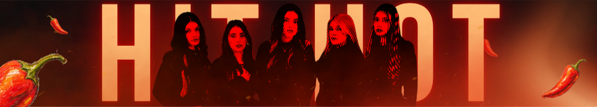
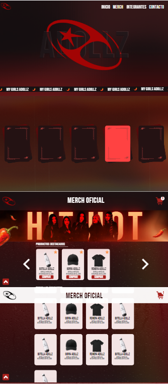
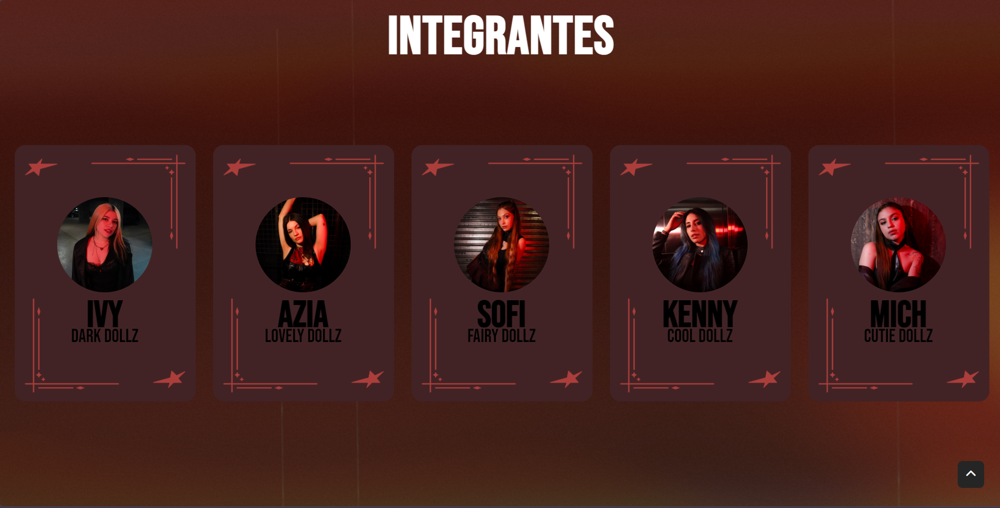
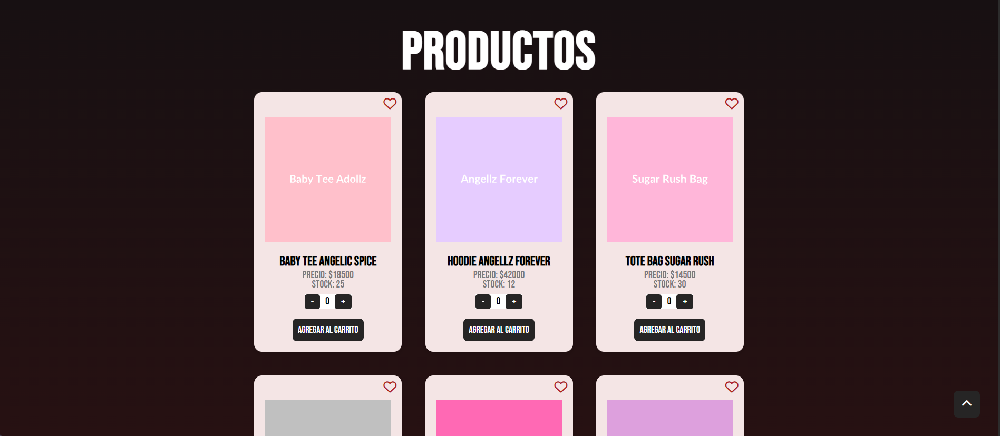

# 💫 [Proyecto Adollz Oficial - Talento Tech](https://adollzfanmadesite.netlify.app/)

## 💻 Desarrollador/a
- Juliana Gimena Grajeda | grajedajulianagimena+academico@gmail.com
## Información del Curso
### 🌃 Turno
- Talento Tech, clase de los Lunes y Miércoles. Turno noche (19 a 21hs).
### 👨‍🏫 Docentes 👩‍🏫
- **Instructor**:  Norberto Llopiz | norberto.llopiz@bue.edu.ar  
- **Tutor**: Tomás Torchinsky Landau | tomas.torchinsky@bue.edu.ar 
## ⚙️ Información del Proyecto
### Descripción

Este proyecto consiste en una página web oficial para el grupo musical argentino Adollz. Fue diseñada 
y desarrollada desde cero como una experiencia interactiva para los fanáticos, permitiendo explorar y navegar 
por una tienda de merchandising completamente funcional.

### 📂 Estructura del proyecto

- Página principal con información institucional de la banda.

### ✨ Funcionalidades principales

- Página principal dedicada a la presentación oficial de la banda.
- Navegación interna entre las diferentes secciones.
- Integración de contenido multimedia.
- Tienda de merchandising con catálogo dinámico cargado mediante Fetch API.

### Concept del diseño de la página

### Secciones que puedes encontrar en el diseño final

- **Comunidad & Redes:** Enlaces a todas sus redes sociales oficiales.

 

- **Tienda(Merch):** Una tienda interactiva desarrollada con JavaScript.

## 🚀 Cómo ejecutar el proyecto

1. Clonar este repositorio.
2. Abrir el proyecto con Visual Studio Code.
3. Ejecutarlo utilizando Live Server.

